# 动漫评论网站

> 🎓 **计算机毕业设计 · 动漫评论网站**
>
> 本仓库只放**项目介绍 + 运行截图**（截图是站点带水印的原图，存在仓库 `images/` 里）。
>
> 👉 **完整可运行源码 / 数据库脚本 / 部署文档：[点我获取](https://geekcode.top/archives/%E5%8A%A8%E6%BC%AB%E8%AF%84%E8%AE%BA%E7%BD%91%E7%AB%99?utm_source=github)**
>
> 💬 咨询微信：**ir9372**　|　🌐 更多项目：[极客代码 geekcode.top](https://geekcode.top/?utm_source=github)
>
> 📌 项目详情页：<https://geekcode.top/archives/%E5%8A%A8%E6%BC%AB%E8%AF%84%E8%AE%BA%E7%BD%91%E7%AB%99?utm_source=github>

<table><td width="230" align="center"> <b>扫码加微信 ir9372</b></td><td valign="middle">📦 源码 = 项目介绍 + 全部运行截图 + 数据库 + 部署文档 👉 点上方任意截图，直接跳到 <b>极客代码 geekcode.top</b> 详情页</td></table>

---

<h1>动漫评论网站</h1>
<h2>项目概述</h2>

本项目为“动漫评论网站”，旨在构建一个集动漫展示、用户互动与内容管理于一体的垂直社区平台。系统采用前后端分离架构，面向动漫爱好者提供热门动漫推荐、新品发布追踪、剧情交流讨论及系统公告浏览功能；同时为管理员提供完善的内容审核、用户管理及数据维护后台。核心业务涵盖动漫资讯展示、用户注册登录、个人中心（发布、收藏）、评论区交互等模块。技术栈基于 Spring Boot 生态，集成 MyBatis-Plus 进行持久层操作，使用 Druid 作为数据库连接池，前端采用 Vue 框架实现响应式界面。该项目适用于动漫社群运营、校园动漫社团管理及小型垂直兴趣社区建设场景，具备高内聚、低耦合的特点，易于扩展与维护。

<h2>技术架构</h2>
<h3>总体架构设计</h3>

本项目采用典型的前后端分离架构模式，整体分为表现层、业务逻辑层和数据访问层。

<a href="https://geekcode.top/archives/%E5%8A%A8%E6%BC%AB%E8%AF%84%E8%AE%BA%E7%BD%91%E7%AB%99?utm_source=github" title="查看完整源码">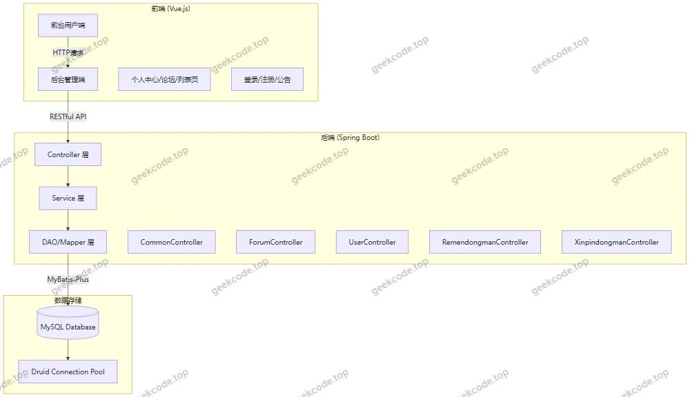</a>

<h3>核心技术选型理由</h3>
<ol>
<li><strong>Spring Boot</strong>：作为基础框架，简化了配置流程，提供了自动装配机制，能够快速搭建稳定且高性能的后端服务，内置的 <code>spring-web</code> 和 <code>spring-webmvc</code> 支持 RESTful 接口开发。</li>
<li><strong>MyBatis-Plus</strong>：在 MyBatis 基础上增强，提供了通用的 CRUD 操作接口，大幅减少了 XML 映射文件的编写工作量，提高了开发效率，适合处理动漫、评论、用户等多表关联业务。</li>
<li><strong>Druid</strong>：阿里巴巴开源的高性能 JDBC 连接池，不仅具备强大的监控功能，还能有效防止 SQL 注入攻击，保障数据库访问的安全性与稳定性。</li>
<li><strong>Vue.js</strong>：前端采用 Vue 框架，结合组件化开发思想，实现了页面的高效渲染与状态管理，提升了用户体验，特别是在动态加载动漫列表和评论数据时表现优异。</li>
</ol>
<h3>数据库设计要点</h3>

数据库主要围绕用户行为与内容实体进行建模。核心实体包括：

<ul>
<li><strong>用户表 (User)</strong>：存储注册用户基本信息及权限标识。</li>
<li><strong>动漫信息表</strong>：分为“热门动漫”与“新品动漫”两类实体，存储标题、简介、封面图等元数据。</li>
<li><strong>评论表 (Discuss)</strong>：分别对应热门动漫与新品动漫的评论记录，包含评论内容、时间、关联ID及用户ID。</li>
<li><strong>论坛帖子表 (Forum)</strong>：用于“剧情交流”板块，存储话题标题、内容及回复信息。</li>
<li><strong>公告表 (News)</strong>：存储系统发布的官方通知。</li>
<li><strong>收藏表 (Storeup)</strong>：记录用户对特定内容的收藏关系。</li>
<li><strong>配置表 (Config)</strong>：存储系统全局参数设置。</li>
</ul>
<h2>功能模块</h2>

根据源码 Controller 列表及截图功能分析，系统功能划分为前台用户端与后台管理端两大部分。

<h3>前台用户端功能</h3>

前台界面主要服务于普通注册用户，提供内容浏览与互动功能。

<ol>
<li><strong>首页导航模块</strong></li>
</ol>
<ul>
<li><strong>热门动漫</strong>：展示当前热度较高的动漫作品列表，支持点击进入详情页查看详细信息及已有评论。</li>
<li><strong>新品动漫</strong>：展示最新上架或发布的动漫作品，提供详情浏览入口。</li>
<li><strong>剧情交流</strong>：即论坛板块，展示用户发布的讨论话题列表，支持查看详情。</li>
<li><strong>系统公告</strong>：展示管理员发布的官方通知列表，支持点击查看公告详情。</li>
</ul>
<ol start="2">
<li><strong>用户认证模块</strong></li>
</ol>
<ul>
<li><strong>登录/注册</strong>：提供标准的账号密码注册与登录界面，确保用户身份合法性。</li>
</ul>
<ol start="3">
<li><strong>个人中心模块</strong></li>
</ol>
<ul>
<li><strong>个人信息管理</strong>：查看和编辑基本个人资料。</li>
<li><strong>我的发布</strong>：展示当前用户发表的所有评论、帖子等内容记录。</li>
<li><strong>我的收藏</strong>：展示用户已收藏的动漫或文章列表，支持取消收藏。</li>
</ul>
<ol start="4">
<li><strong>互动功能</strong></li>
</ol>
<ul>
<li><strong>评论系统</strong>：在热门动漫、新品动漫详情页以及剧情交流帖下，允许登录用户发表评论。</li>
<li><strong>收藏系统</strong>：用户可对感兴趣的动漫内容进行标记收藏。</li>
</ul>
<h3>后台管理端功能</h3>

后台界面服务于系统管理员，提供全面的数据管理与内容审核能力。

<ol>
<li><strong>内容管理模块</strong></li>
</ol>
<ul>
<li><strong>热门动漫管理 (<code>/remendongman</code>)</strong>：对热门动漫数据进行增删改查操作。</li>
<li><strong>新品动漫管理 (<code>/xinpindongman</code>)</strong>：对新品动漫数据进行增删改查操作。</li>
<li><strong>动漫类型管理 (<code>/dongmanleixing</code>)</strong>：维护动漫的分类标签体系，便于前台筛选展示。</li>
<li><strong>系统公告管理 (<code>/news</code>)</strong>：发布、编辑或删除系统通知，控制前台公告栏显示内容。</li>
</ul>
<ol start="2">
<li><strong>社区互动管理模块</strong></li>
</ol>
<ul>
<li><strong>论坛管理 (<code>/forum</code>)</strong>：管理剧情交流板块的帖子，包括删除违规内容、置顶优质话题等。</li>
<li><strong>评论管理 (<code>/discussremendongman</code>, <code>/discussxinpindongman</code>)</strong>：分别管理热门动漫和新品动漫下的用户评论，支持审核、删除不良言论。</li>
</ul>
<ol start="3">
<li><strong>用户与权限管理模块</strong></li>
</ol>
<ul>
<li><strong>用户管理 (<code>/yonghu</code>)</strong>：查看所有注册用户信息，执行禁用、重置密码等操作。</li>
<li><strong>管理员账户 (<code>/users</code>)</strong>：管理系统内部管理员账号及其权限配置。</li>
</ul>
<ol start="4">
<li><strong>系统配置模块</strong></li>
</ol>
<ul>
<li><strong>参数配置 (<code>/config</code>)</strong>：修改网站名称、Logo、版权信息等全局配置项。</li>
<li><strong>文件上传 (<code>FileController</code>)</strong>：提供图片、视频等静态资源的上传与管理接口，支撑前端展示需求。</li>
</ul>
<h2>用户角色与权限</h2>

本系统主要涉及两种角色：<strong>普通用户</strong>与<strong>系统管理员</strong>。不同角色拥有不同的操作权限与可见范围。

<h3>1. 普通用户 (Regular User)</h3>
<ul>
<li><strong>定义</strong>：通过前台注册页面创建账号的动漫爱好者。</li>
<li><strong>权限描述</strong>：</li>
<li><strong>浏览权限</strong>：可无限制浏览前台所有公开内容，包括热门动漫、新品动漫、剧情交流列表及系统公告。</li>
<li><strong>互动权限</strong>：登录后，可在动漫详情页发表评论，参与剧情交流发帖，以及对内容进行收藏。</li>
<li><strong>个人数据管理</strong>：仅能查看和管理自己的数据，包括修改个人资料、查看“我的发布”记录和“我的收藏”列表。</li>
<li><strong>限制</strong>：无法进入后台管理系统，无权修改任何公共数据或其他用户数据，无权删除他人评论。</li>
</ul>
<h3>2. 系统管理员 (Admin)</h3>
<ul>
<li><strong>定义</strong>：负责网站日常运营、内容审核及技术维护的高级用户。</li>
<li><strong>权限描述</strong>：</li>
<li><strong>全量数据管理</strong>：拥有对所有业务表（动漫、公告、论坛、评论、用户）的完整 CRUD（增删改查）权限。</li>
<li><strong>内容审核权</strong>：有权删除违规的评论、帖子或公告，维护社区秩序。</li>
<li><strong>用户管理权</strong>：可查看全体用户列表，对异常账号进行封禁或解封操作。</li>
<li><strong>系统配置权</strong>：可修改网站全局参数（如站点名称、轮播图配置等），管理管理员账号体系。</li>
<li><strong>入口隔离</strong>：管理员通常通过独立的后台路由（如 <code>/admin</code> 相关路径）登录，与普通用户前台入口物理或逻辑隔离。</li>
</ul>
<h2>项目特色与创新点</h2>
<h3>1. 垂直领域的精细化内容分类</h3>

区别于综合性动漫网站，本项目将动漫资源明确划分为“热门动漫”与“新品动漫”两个独立维度，并分别建立了独立的评论管理体系（<code>Discussremendongman</code> 与 <code>Discussxinpindongman</code>）。这种设计使得用户能够更精准地获取感兴趣的内容类型，同时也便于管理员针对不同热度的内容采取差异化的运营策略。

<h3>2. 社区互动与资讯展示的深度融合</h3>

系统将传统的资讯展示（动漫详情、公告）与 UGC（用户生成内容，如评论、论坛帖子）紧密结合。前台设有专门的“剧情交流”板块，不仅限于简单的留言，而是形成了以动漫为核心的讨论社区。个人中心提供的“我的发布”功能，增强了用户的归属感和参与度，构建了从“看”到“聊”再到“管”的完整闭环。

<h3>3. 基于 MyBatis-Plus 的高效数据交互</h3>

利用 MyBatis-Plus 的特性，项目在保持 SQL 灵活性的同时，极大地简化了通用查询代码。对于动漫列表的分页查询、评论的多条件筛选（按用户、按动漫ID、按时间排序）等高频操作，实现了零侵入式的快速开发。结合 Druid 连接池的监控能力，确保了在高并发访问评论区和动漫详情页时的数据库性能稳定性。

<h3>4. 前后端分离下的模块化路由设计</h3>

后台采用了清晰的路由划分（如 <code>/forum</code>, <code>/news</code>, <code>/storeup</code> 等），每个模块对应独立的 Controller 和业务逻辑。这种模块化设计降低了代码耦合度，使得新增功能（如未来增加“周边商城”或“投票活动”）只需添加新的 Controller 和 Service 即可，无需重构原有代码，具备良好的可维护性和扩展性。

<h2>部署环境</h2>

为确保项目正常运行，需准备以下软硬件环境：

<h3>1. 硬件环境建议</h3>
<ul>
<li><strong>CPU</strong>：Intel Core i5 及以上处理器</li>
<li><strong>内存</strong>：8GB RAM 及以上（建议开发机至少 16GB 以流畅运行 IDE 和浏览器）</li>
<li><strong>硬盘</strong>：SSD 固态硬盘，剩余空间不少于 50GB</li>
</ul>
<h3>2. 软件环境要求</h3>
<ul>
<li><strong>操作系统</strong>：Windows 10/11, macOS 或 Linux (CentOS/Ubuntu)</li>
<li><strong>JDK 版本</strong>：Java Development Kit 1.8 或更高版本（兼容 Java 11/17）</li>
<li><strong>Maven</strong>：Apache Maven 3.6+，用于依赖管理和项目构建</li>
<li><strong>数据库</strong>：MySQL 5.7 或 MySQL 8.0，需启用 InnoDB 引擎以支持事务</li>
<li><strong>Node.js</strong>：版本 14.x - 16.x LTS，用于前端 Vue 项目的依赖安装与打包</li>
<li><strong>IDE</strong>：IntelliJ IDEA (Ultimate 版推荐) 或 Eclipse，VS Code (用于前端开发)</li>
<li><strong>浏览器</strong>：Chrome, Edge, Firefox 等现代主流浏览器</li>
</ul>
<h3>3. 部署步骤简述</h3>
<ol>
<li><strong>数据库初始化</strong>：导入项目提供的 SQL 脚本，创建数据库实例及表结构。</li>
<li><strong>后端配置</strong>：修改 <code>application.yml</code> 或 <code>application.properties</code> 中的数据库连接 URL、用户名、密码以及端口号。</li>
<li><strong>后端启动</strong>：使用 Maven 命令 <code>mvn clean install</code> 编译项目，然后运行主 Application 类启动 Spring Boot 服务。</li>
<li><strong>前端配置</strong>：进入前端项目目录，修改 API 请求的基础地址指向后端服务 IP 和端口。</li>
<li><strong>前端启动</strong>：执行 <code>npm install</code> 安装依赖，随后运行 <code>npm run serve</code> (开发模式) 或 <code>npm run build</code> (生产模式) 启动前端应用。</li>
</ol>
<h2>五、技术特性</h2>
<ul>
<li>前后端集成部署，前端资源打包至后端 static 目录</li>
<li>使用 MyBatis-Plus 简化数据访问层开发</li>
</ul>
<h2>六、功能模块截图</h2>
<h3>前台用户端</h3>
<h4>前台首页</h4>

<a href="https://geekcode.top/archives/%E5%8A%A8%E6%BC%AB%E8%AF%84%E8%AE%BA%E7%BD%91%E7%AB%99?utm_source=github" title="查看完整源码">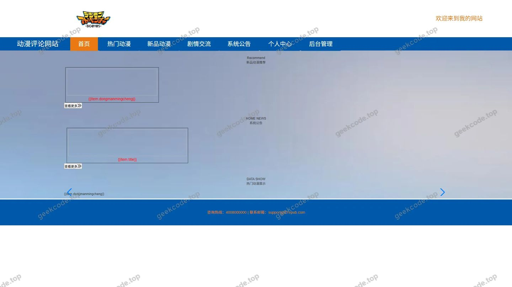</a>

<h4>前台登录页</h4>

<a href="https://geekcode.top/archives/%E5%8A%A8%E6%BC%AB%E8%AF%84%E8%AE%BA%E7%BD%91%E7%AB%99?utm_source=github" title="查看完整源码">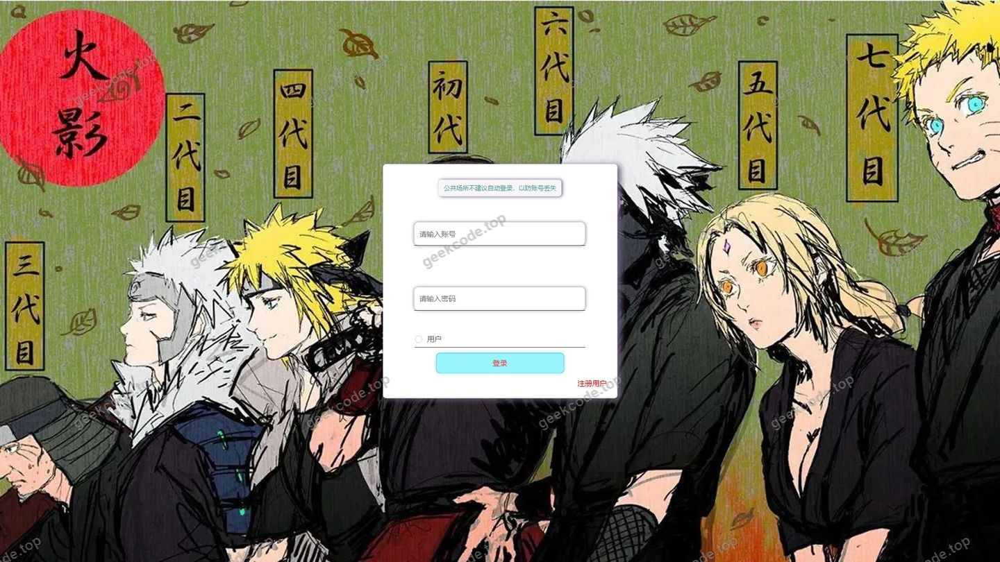</a>

<h4>前台注册页</h4>

<a href="https://geekcode.top/archives/%E5%8A%A8%E6%BC%AB%E8%AF%84%E8%AE%BA%E7%BD%91%E7%AB%99?utm_source=github" title="查看完整源码">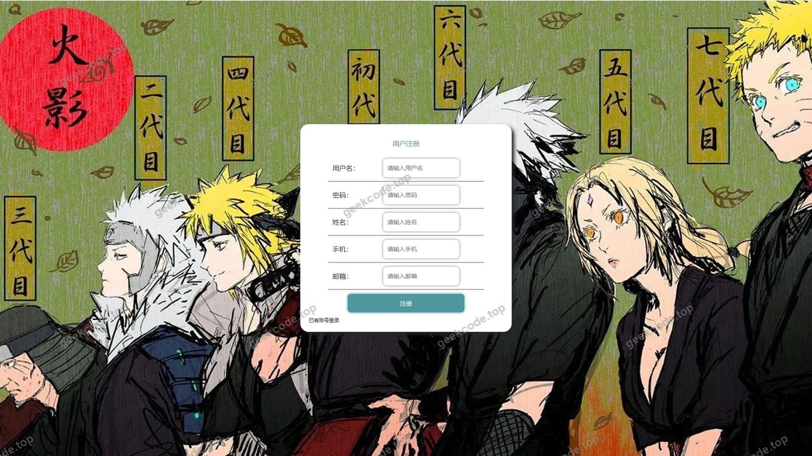</a>

<h4>前台-剧情交流列表</h4>

<h4>前台-系统公告列表</h4>

<a href="https://geekcode.top/archives/%E5%8A%A8%E6%BC%AB%E8%AF%84%E8%AE%BA%E7%BD%91%E7%AB%99?utm_source=github" title="查看完整源码">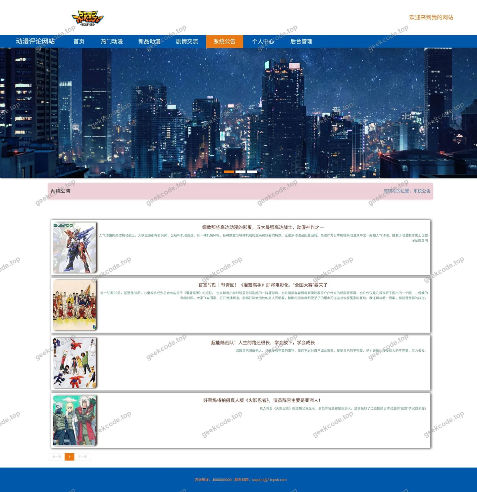</a>

<h4>前台-热门动漫列表</h4>

<a href="https://geekcode.top/archives/%E5%8A%A8%E6%BC%AB%E8%AF%84%E8%AE%BA%E7%BD%91%E7%AB%99?utm_source=github" title="查看完整源码">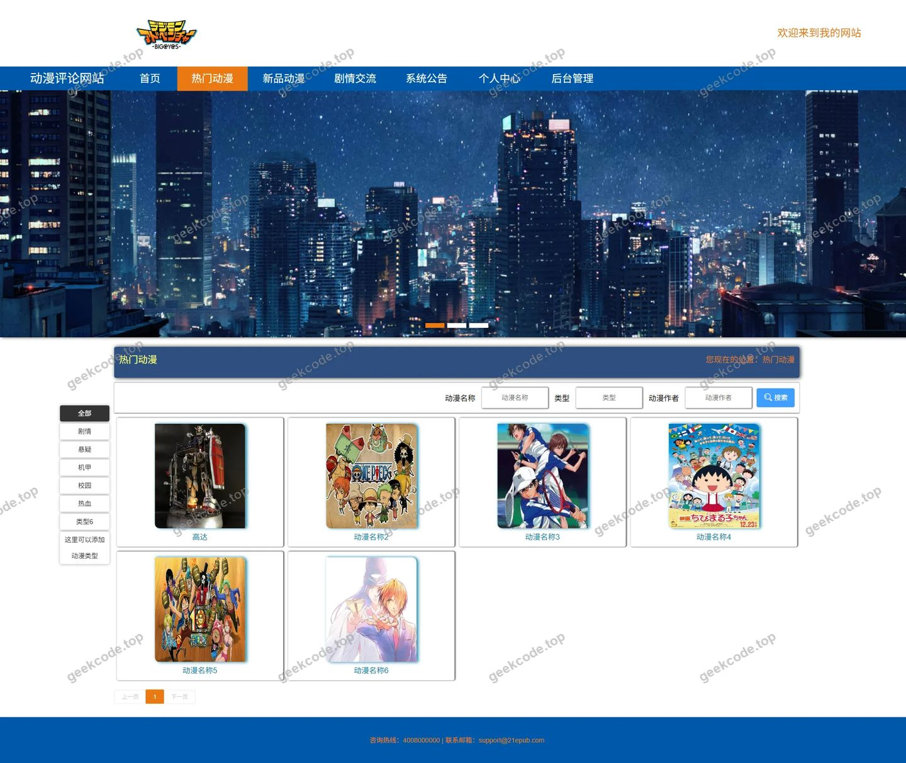</a>

<h4>前台-新品动漫列表</h4>

<a href="https://geekcode.top/archives/%E5%8A%A8%E6%BC%AB%E8%AF%84%E8%AE%BA%E7%BD%91%E7%AB%99?utm_source=github" title="查看完整源码">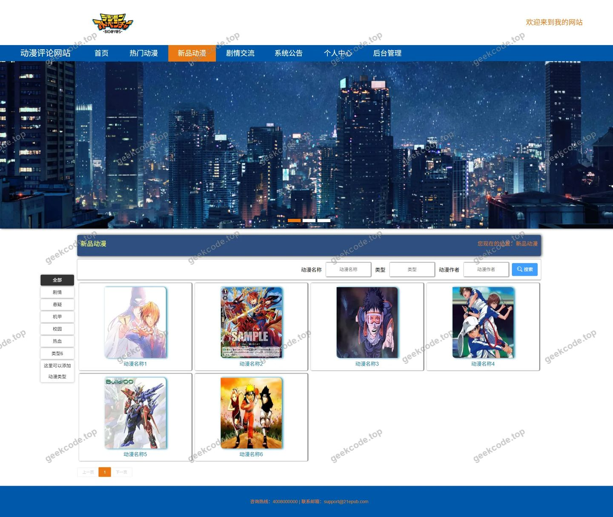</a>

<h4>前台个人中心</h4>

<a href="https://geekcode.top/archives/%E5%8A%A8%E6%BC%AB%E8%AF%84%E8%AE%BA%E7%BD%91%E7%AB%99?utm_source=github" title="查看完整源码">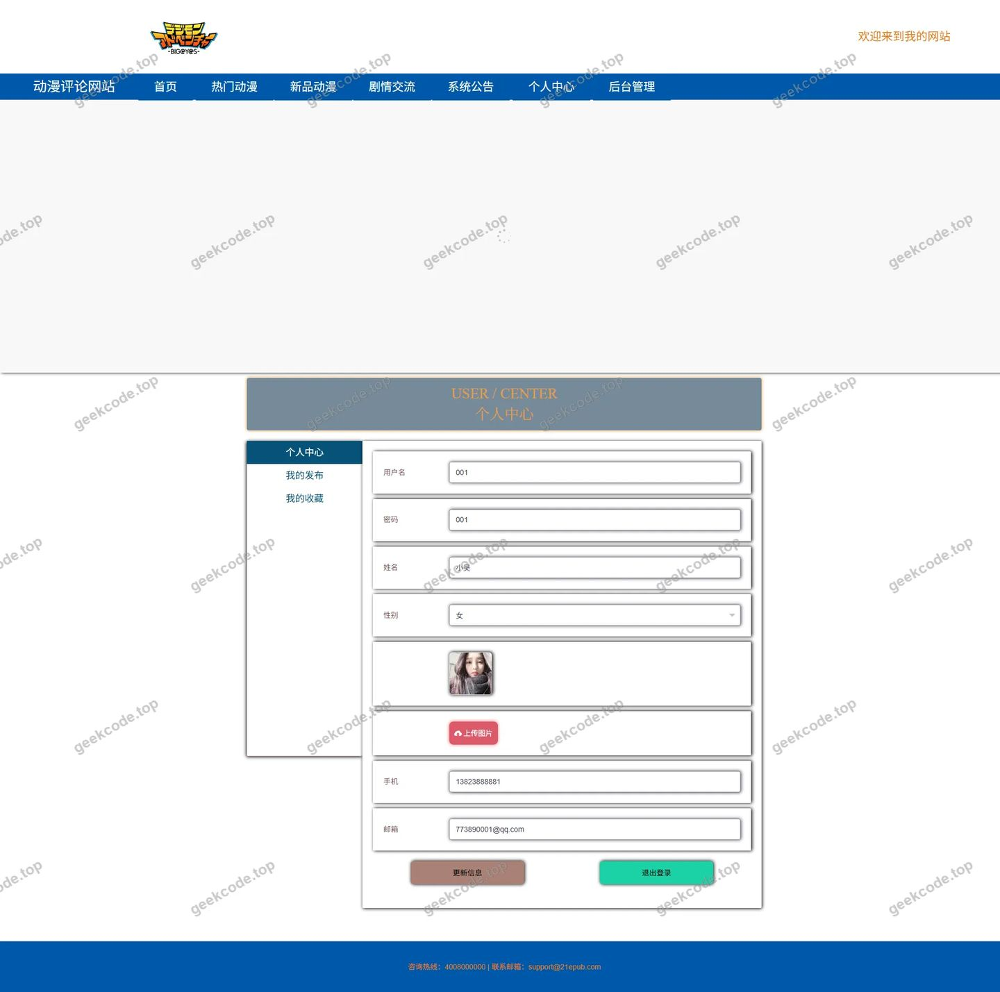</a>

<h4>前台-剧情交流详情</h4>

<a href="https://geekcode.top/archives/%E5%8A%A8%E6%BC%AB%E8%AF%84%E8%AE%BA%E7%BD%91%E7%AB%99?utm_source=github" title="查看完整源码">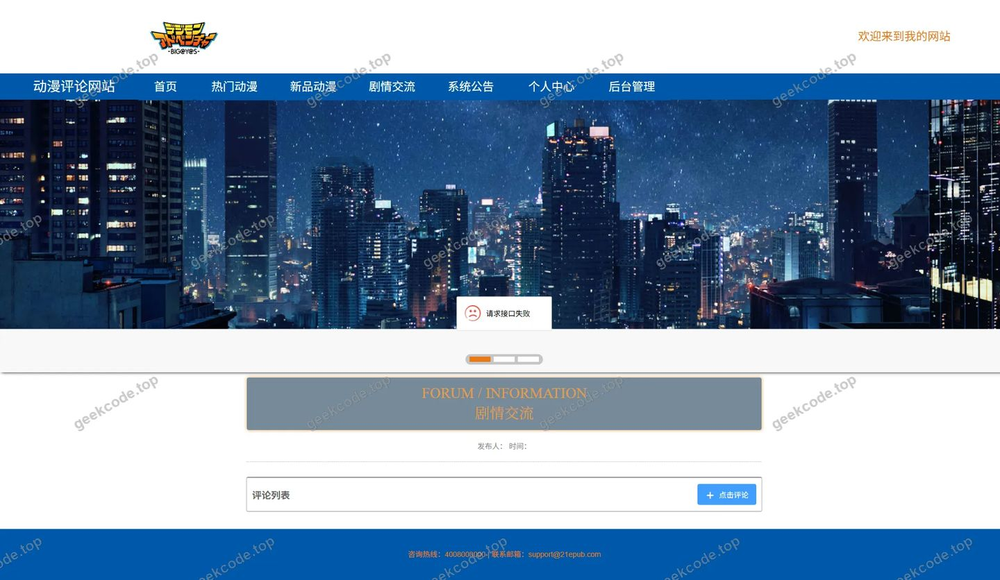</a>

<h4>前台-系统公告详情</h4>

<h4>前台-热门动漫详情</h4>

<a href="https://geekcode.top/archives/%E5%8A%A8%E6%BC%AB%E8%AF%84%E8%AE%BA%E7%BD%91%E7%AB%99?utm_source=github" title="查看完整源码">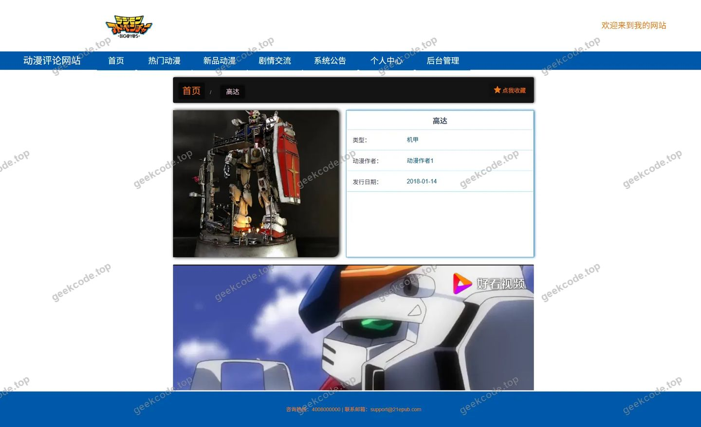</a>

<h4>前台-新品动漫详情</h4>

<a href="https://geekcode.top/archives/%E5%8A%A8%E6%BC%AB%E8%AF%84%E8%AE%BA%E7%BD%91%E7%AB%99?utm_source=github" title="查看完整源码">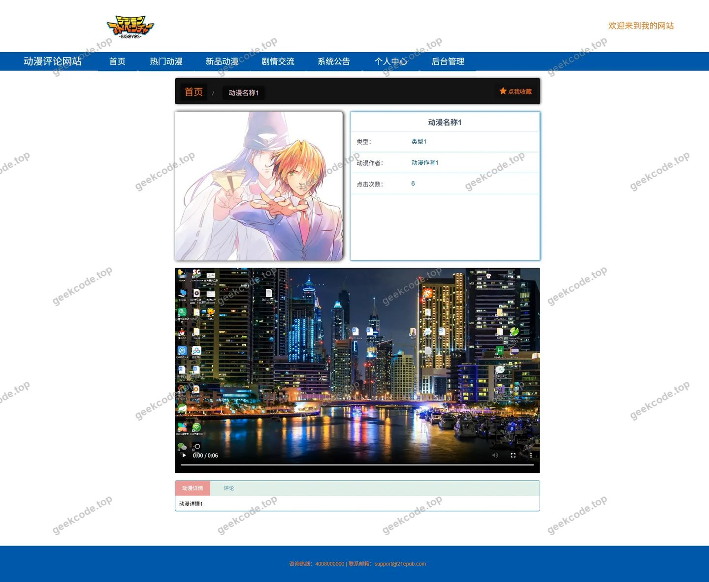</a>

<h3>后台管理端</h3>
<h4>后台-登录页</h4>

<h4>后台-热门动漫</h4>

<a href="https://geekcode.top/archives/%E5%8A%A8%E6%BC%AB%E8%AF%84%E8%AE%BA%E7%BD%91%E7%AB%99?utm_source=github" title="查看完整源码">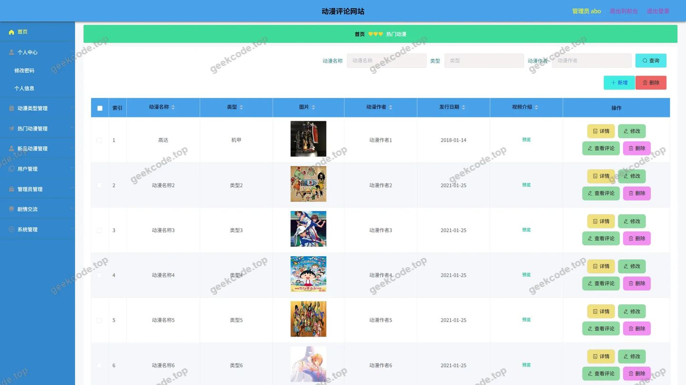</a>

<h4>后台-热门动漫评论</h4>

<a href="https://geekcode.top/archives/%E5%8A%A8%E6%BC%AB%E8%AF%84%E8%AE%BA%E7%BD%91%E7%AB%99?utm_source=github" title="查看完整源码">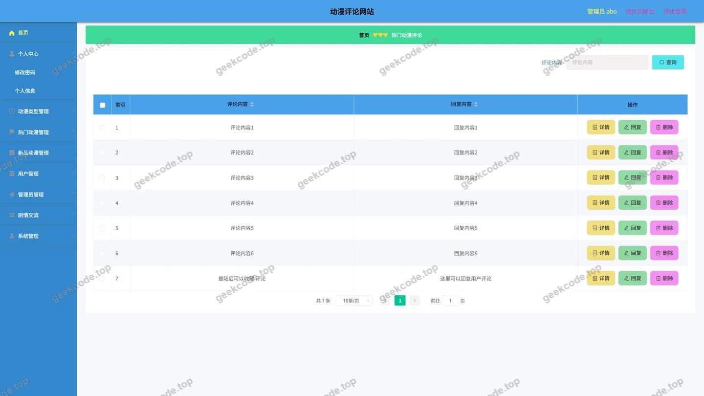</a>

<h4>后台首页</h4>

<a href="https://geekcode.top/archives/%E5%8A%A8%E6%BC%AB%E8%AF%84%E8%AE%BA%E7%BD%91%E7%AB%99?utm_source=github" title="查看完整源码">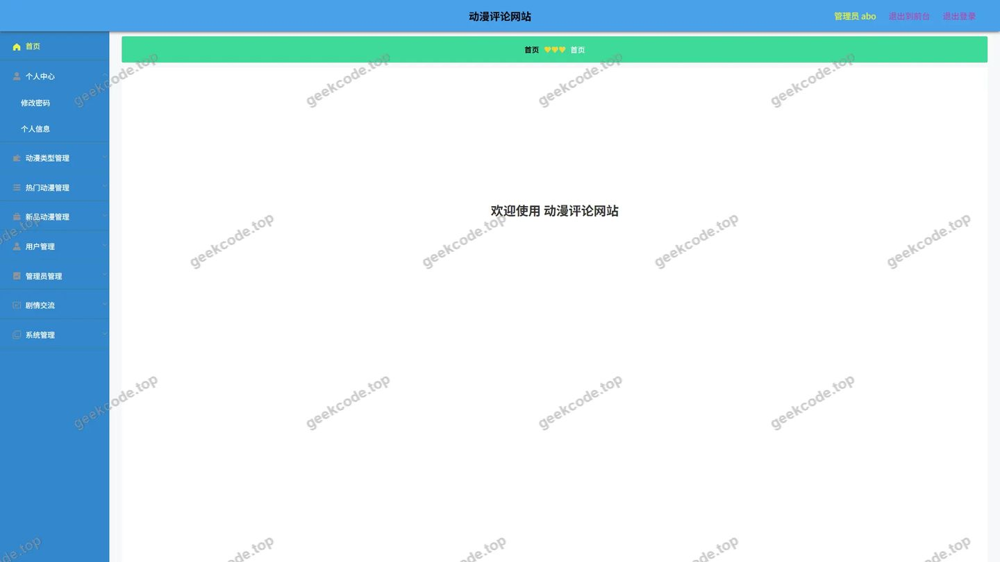</a>

<h4>后台-系统公告</h4>

<a href="https://geekcode.top/archives/%E5%8A%A8%E6%BC%AB%E8%AF%84%E8%AE%BA%E7%BD%91%E7%AB%99?utm_source=github" title="查看完整源码">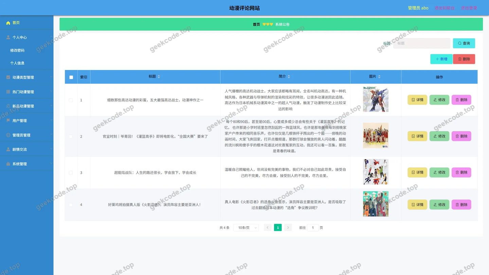</a>

<h4>后台-新品动漫</h4>

<a href="https://geekcode.top/archives/%E5%8A%A8%E6%BC%AB%E8%AF%84%E8%AE%BA%E7%BD%91%E7%AB%99?utm_source=github" title="查看完整源码">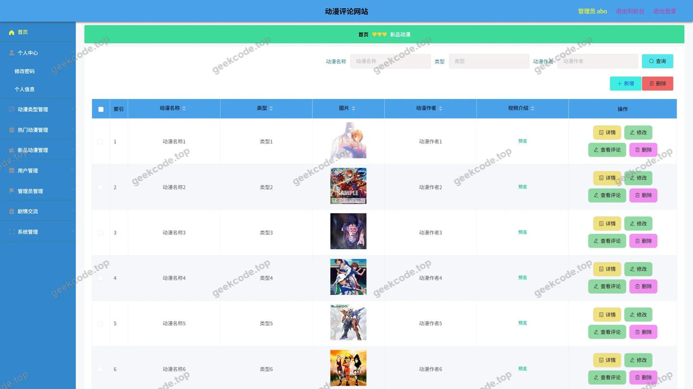</a>

<h4>后台-新品动漫评论</h4>

<a href="https://geekcode.top/archives/%E5%8A%A8%E6%BC%AB%E8%AF%84%E8%AE%BA%E7%BD%91%E7%AB%99?utm_source=github" title="查看完整源码">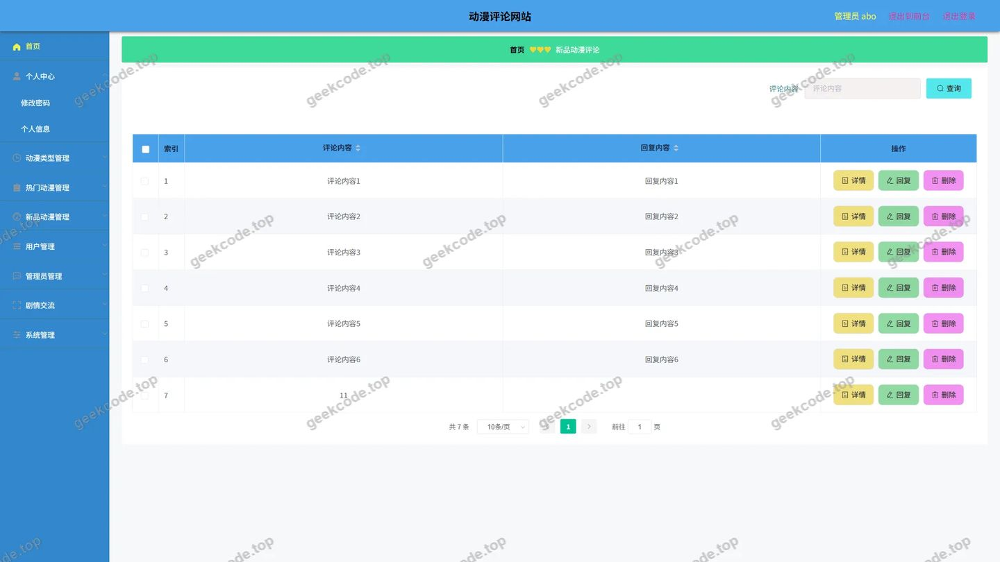</a>

<h4>后台-用户</h4>

<a href="https://geekcode.top/archives/%E5%8A%A8%E6%BC%AB%E8%AF%84%E8%AE%BA%E7%BD%91%E7%AB%99?utm_source=github" title="查看完整源码">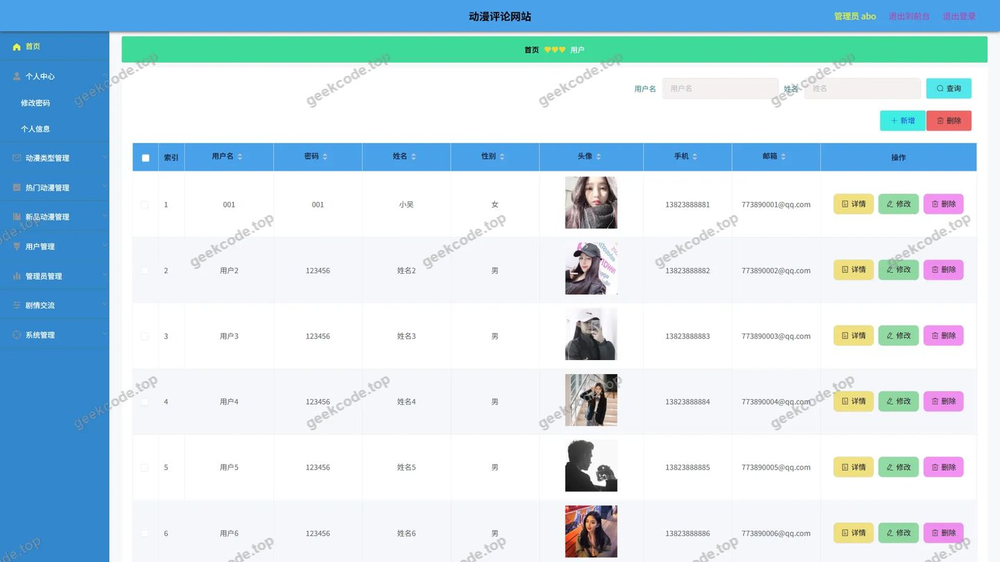</a>

---

## 获取完整源码

| 项目 | 说明 |
| --- | --- |
| 项目名 | 动漫评论网站 |
| 运行截图 | 本文 21 张（站点带水印原图，仓库 `images/` 目录） |
| 完整源码 | [https://geekcode.top/archives/%E5%8A%A8%E6%BC%AB%E8%AF%84%E8%AE%BA%E7%BD%91%E7%AB%99?utm_source=github](https://geekcode.top/archives/%E5%8A%A8%E6%BC%AB%E8%AF%84%E8%AE%BA%E7%BD%91%E7%AB%99?utm_source=github) |
| 咨询微信 | **ir9372**（备注：jingpin-yuanma） |
| 更多项目 | [极客代码 geekcode.top](https://geekcode.top/?utm_source=github) |

> 需要源码、部署、改配置、跑不起来等问题，加微信 ir9372 沟通，说明项目名即可。
